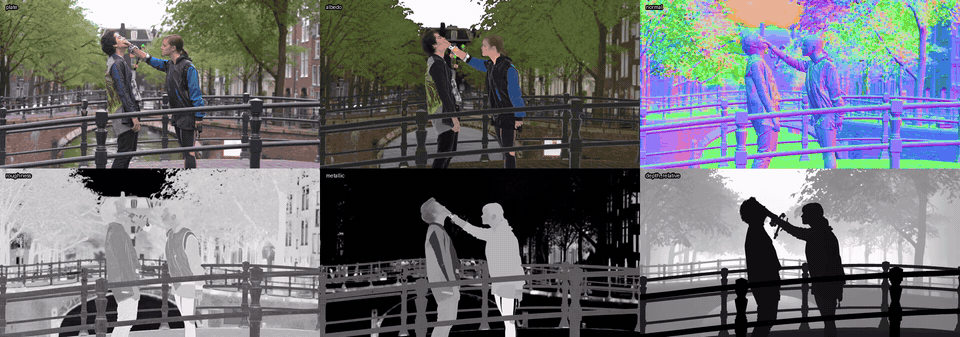
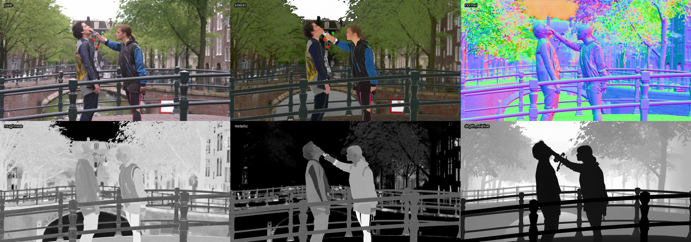
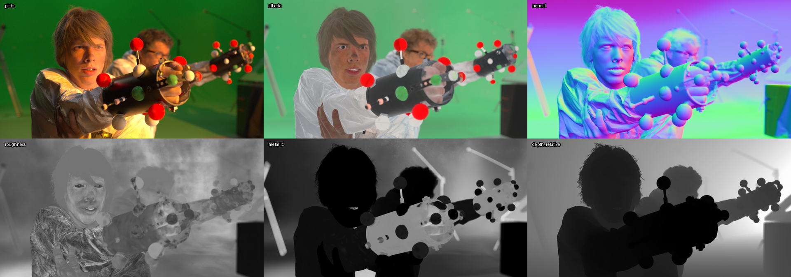

# Medratools: PlateAOVs for Nuke

PlateAOVs adds a **Medratools > PlateAOVs** node to Nuke. It extracts material passes from a live-action plate, as a Nuke node: **albedo** (surface
colour with the lighting removed), camera-space **normal**, **roughness**,
**metallic** and, optionally, **relative depth**.

It runs the inverse renderer of NVIDIA's
[Cosmos DiffusionRenderer](https://github.com/nv-tlabs/cosmos1-diffusion-renderer)
(CVPR 2025), a 7B video DiT, 57 frames at a time. The model runs in its own
Python environment as a subprocess; Nuke never imports torch.

The passes are estimates from a generative model, not physical measurements.
Metallic and roughness in particular can be wrong on outdoor scenes (bricks or
trousers read as metal), and normals can be noisy on foliage. Check every shot.

## Examples

Plate, then albedo, normal, roughness, metallic and relative depth, from
*Tears of Steel* shots (72 frames each, computed with the default 8 steps):



Full-quality videos: [shot 050](docs/tos050-passes.mp4),
[shot 070](docs/tos070-passes.mp4). Stills:




Plates: *Tears of Steel* © Blender Foundation | mango.blender.org, licensed
[CC BY 3.0](https://creativecommons.org/licenses/by/3.0/). The passes shown
are model output and carry the limits described above (for example, the
trousers and jacket on the right read as partly metallic).

## Requirements

- Linux x86-64 (developed and tested on Arch Linux; Windows is untested).
- An NVIDIA GPU. Tested on an RTX 3090 (24 GB); see [VRAM modes](#vram-modes)
  for smaller cards. CUDA 12.4 wheels are installed by `setup.sh`.
- Nuke 17.1 (the node is a Group built with Python; NukeX was used in testing).
- [`uv`](https://docs.astral.sh/uv/), `git`, ~35 GB of free disk
  (27 GB model + 1.8 GB tokenizer + the environment).
- RAM: loading peaked at ~35 GiB resident in testing (mostly the memory-mapped
  checkpoint, which the OS can reclaim). A hard minimum was not measured.

## Install

```bash
git clone https://github.com/neuralcheckpoint/plateaovs-nuke.git
cd plateaovs-nuke
./setup.sh
```

`setup.sh` is safe to re-run. It creates a Python 3.10 `.venv` (torch 2.6,
CUDA 12.4), clones the Cosmos code into `vendor/` at a pinned commit, and
downloads the weights from Hugging Face into `models/checkpoints/`
(`nvidia/Diffusion_Renderer_Inverse_Cosmos_7B` and
`nvidia/Cosmos-Tokenize1-CV8x8x8-720p`). If Hugging Face asks for it, log in
with `.venv/bin/hf auth login` and accept the model licence on the model page.

Then register the plugin with Nuke, in `~/.nuke/init.py`:

```python
import nuke
nuke.pluginAddPath("/path/to/PlateAOVs/nuke_plugin")
```

Restart Nuke. The tool appears as **Nodes > Medratools > PlateAOVs**.
To use another interpreter for the engine, set `PLATEAOVS_PYTHON` to its path.

Check the install without a GPU:

```bash
.venv/bin/python -m pytest -q tests/test_engine.py tests/test_quantization.py
```

## Use in Nuke

Create the node after the plate, tick the passes you want and press
**Compute**. It runs in the background (progress bar, cancel, time left) and
the node reloads its cache when done. The plate passes through untouched and
the passes are added as layers: `albedo`, `normal`, `roughness`, `metallic`
and `depth_relative`.

| Knob | What it does |
|---|---|
| passes | Which passes to compute. Depth is off by default. |
| show | `Plate` (plate plus layers) or one pass in rgb, for a look. |
| DiT weights | `bf16` (original weights, default) or `int8` (less VRAM). |
| low VRAM | Streams DiT blocks from RAM and tiles the tokenizer. Off by default. |
| this frame | Computes only the current frame (~15 s per pass) to preview a shot. |
| source | `Auto` reads the Read feeding the node directly; `Render input` renders whatever is upstream to EXR first. |
| Compute / Recompute all | Compute only does frames that are missing or whose input changed. |

The cache is per frame: changing the range or computing one frame does not
wipe the shot. Changing passes, source, precision or low VRAM starts a new
cache, and the GUI asks before deleting the old one (headless runs do not ask).
Extending the range cross-fades the new window into frames already on disk.

## Command line

The engine can run without Nuke:

```bash
.venv/bin/python -m plateaovs --input plate.####.exr --output cache/aovs.####.exr \
    --first 1001 --last 1072 [--passes basecolor normal roughness metallic depth] \
    [--overlap 8] [--steps 8] [--precision bf16|int8] [--low-vram] \
    [--window 57|1] [--transfer auto|linear|display] [--force]
```

Output is one EXR per frame. It prints one JSON progress event per line.

## Channel conventions

| layer | channels | content |
|---|---|---|
| `albedo` | rgb | base colour, linear (the model outputs sRGB; the engine linearises it) |
| `normal` | rgb | unit normal in camera space: x right, y up, z towards the camera |
| `roughness` | red | 0 smooth to 1 rough |
| `metallic` | red | 0 dielectric to 1 metal |
| `depth_relative` | red | 0 near to 1 far, rescaled per window, so it is not stable across a long shot and not in metres |

## How it works

1. Each frame is converted to display (sRGB) if the plate is linear and
   stretched to 1280×704, the training resolution. Other sizes, including
   960×528 and vertical 704×1280, give wrong passes. Output goes back to the
   plate's size.
2. The plate goes through the model in windows of 57 frames (the only length
   the video tokenizer accepts) with 8 frames of overlap, cross-faded to avoid
   a jump. A shorter shot is padded by repeating its last frame.
3. Each pass is an 8-step sample with guidance 0 and seed 1000. The reference
   code uses 15 steps; at 8 the difference to 15 is about 10× smaller than the
   difference between two seeds, with the same flicker and 1.8× less time.
4. NVIDIA's Transformer Engine is not needed: RMSNorm, rotary embeddings and
   attention are replaced by PyTorch equivalents in `plateaovs/model.py`, and
   the checkpoint loads key for key.

## VRAM modes

Measured on an RTX 3090 with the CUDA allocator capped to simulate smaller
cards (**not on physical 8 or 16 GB cards**; the cap excludes the CUDA context,
~0.3 GiB, and anything else using the GPU). Muay thai clip, 113 frames, three
windows, five passes, 1280×704, 8 steps.

| Mode | Peak VRAM (allocated / reserved) | Total time |
|---|---|---|
| bf16 | 17.8 / 18.2 GiB | 1654 s |
| `int8` | 11.2 / 12.0 GiB | 1680 s |
| `int8` + low VRAM | 4.4 / 4.7 GiB | 1637 s |

- **int8** is weight-only, symmetric, per channel, on the linear layers.
  Activations, matmuls and the tokenizer stay bf16, and there is no extra
  quantisation dependency. It saves memory, it does not speed anything up.
- **low VRAM** keeps the DiT blocks in pinned RAM and copies the next block to
  the GPU on a side stream while the current one computes. The tokenizer runs
  in 2×2 spatial tiles with a 128 px halo; the tile blend is approximate, not
  bit-identical. Expect about 35 GiB of host RAM (largely reclaimable mmap).
- Against bf16, int8 differs by a median of 0.004–0.010 per pass (0–1 scale),
  roughly 10× below the seed-to-seed variation. Flicker did not get worse on
  the clips tested; that does not guarantee other shots.
- Timing on the 3090 at 8 steps: about 1.9 s per frame per pass (a 57-frame
  window with five passes takes roughly 9 minutes), plus 15–45 s to load.

## Tests

- `tests/test_engine.py`, `tests/test_quantization.py`: CPU only. Windows,
  blending, per-frame cache behaviour, albedo linearisation, int8 error bounds,
  tile blending.
- `tests/nuke_smoke.py`: in Nuke, on the GPU (~15 min). Set
  `PLATEAOVS_TEST_PLATE` to an EXR sequence (frames 1001–1012) of a person
  facing the camera on a floor, then:
  `Nuke17.1 -i --nukex -t tests/nuke_smoke.py <scratch dir>`.


## Licences

The code in this repository is Apache-2.0. The Cosmos DiffusionRenderer code
(cloned by `setup.sh`) is Apache-2.0; its weights are under the
[NVIDIA Open Model License](https://www.nvidia.com/en-us/agreements/enterprise-software/nvidia-open-model-license/),
which allows commercial use. Read it before you ship anything made with them.
